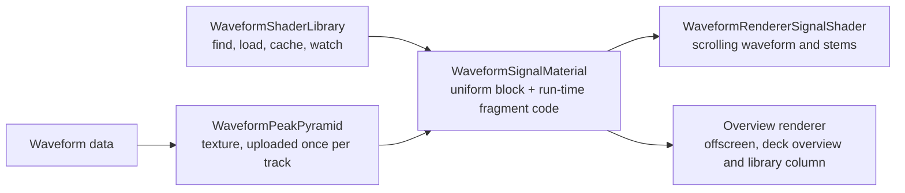

<!-- [AI-generated by Claude — start] -->

# Waveform Shader Packages

* **Owners:**
  * `@v1vendi`

* **Implementation Status:** `Partially implemented` (working prototype, not yet proposed as PRs)

* **Related Issues and PRs:** see [Related work](#related-work) for the full list.
  * Bug fixes found while building this, independent of the proposal:
    [v1vendi/mixxx `fix/allshader-hsv-and-stem-gain`](https://github.com/v1vendi/mixxx/tree/fix/allshader-hsv-and-stem-gain)
    (the AllShader HSV renderer ignores the hue of the low color; the AllShader stem renderer applies the overall gain
    twice)
  * Overview of open waveform issues: mixxxdj/mixxx#15537

* **Other docs or links:**
  * Prototype branches (to be pushed to v1vendi/mixxx): `pr/waveform-shaders`, `feature/overview-shaders`,
    `experiment/drop-legacy-waveforms`

> TL;DR: Draw the AllShader waveform signal with small GLSL fragment shaders ("shader packages") that Mixxx loads from
> disk at run time, instead of one C++ renderer per waveform type. The stock looks (RGB, HSV, Filtered, RGB Stacked,
> stems, high detail, slip) ship as packages and look the same as today. Users can add their own looks
> without recompiling Mixxx, and saving a shader file reloads it while Mixxx runs. The same packages draw the scrolling
> waveform, the deck overview and the library waveform column. Packages show up in the existing waveform type list,
> with no new setting, and picking one switches all of them at once. The
> prototype is about 4,000 added lines; this document proposes landing it as 7 PRs in a fixed order: stock behavior
> stays unchanged until users can choose packages, a separate PR makes them the default, and a last PR removes the
> legacy waveform code (about 6,400 lines).

## Why

A new waveform look today means a new C++ renderer class, a new waveform type in the factory and preferences, and a
new Mixxx release. That is why only a handful of looks exist, why skins can only pick colors, and why many requests
for other looks stay open (see [Related work](#related-work)). Several open PRs each add one more C++ waveform type.

Mixxx already draws its waveforms with GLSL: since 2.4 the AllShader ("GLSL") types use OpenGL shaders
([Improved waveforms in Mixxx 2.4](https://mixxx.org/news/2024-02-23-improved-waveforms/), mixxxdj/mixxx#10989). Those
shaders are fixed and compiled into Mixxx, though, and most of them only fill in geometry that C++ builds: the shape and
colors of the waveform are still decided per waveform type in C++. This proposal moves that decision into a fragment
shader that Mixxx loads from a file.

The AllShader renderers without high detail, and the HSV, Simple and stem renderers, build vertex geometry on the CPU
for every pixel column of every frame. The high detail RGB, Filtered and Stacked types already read the waveform from
a texture (`WaveformRendererTextured`, mixxxdj/mixxx#13151), but that renderer is a port of the legacy GLSL code with
one hard-coded shader per type and no OpenGL ES support. In the prototype, one fragment shader path that reads a peak
texture draws all types, with less work than either:

| Type (1608×59 widget, Apple M1, µs/frame, min) | Stock | Shader |
| ---------------------------------------------- | ----: | -----: |
| rgb                                            |  72.9 |   20.0 |
| rgb high detail (stock: textured)              | 414.3 |   57.8 |
| hsv                                            | 154.0 |   22.9 |
| filtered                                       | 117.5 |   14.5 |
| filtered high detail (stock: textured)         | 294.5 |   43.5 |
| stacked                                        | 119.8 |   14.7 |
| stacked high detail (stock: textured)          | 426.3 |   51.9 |
| stems                                          |  74.2 |   21.2 |

The stock rows without high detail vary between runs, so they are rough.

### Pitfalls of the current solution

* Every look is C++. Users cannot change how the signal is drawn.
* The renderers duplicate the same data access, gain and color code per type, with small differences that drift:
  different peak sizes (mixxxdj/mixxx#15322), colors that differ between the scrolling waveform and the overview
  (mixxxdj/mixxx#14813, mixxxdj/mixxx#12449), and the two bugs fixed in the branch above.
* The deck overview and the library waveform column have a third, separate QPainter implementation of the same looks,
  with its own type list and its own gaps (no stacked overview, mixxxdj/mixxx#13265).
* The CPU cost per frame grows with widget width and with high detail.

## Goals

* Draw the AllShader waveform signal with a fragment shader loaded from disk at run time.
* Ship packages that reproduce the stock types (RGB, HSV, Filtered, RGB Stacked, their high detail variants, slip and
  stems). Fewer than 0.02% of pixels differ by more than 10% from the stock renderers for all types except stems,
  which only differ because of the stock gain bug.
* Draw the deck overview and the library waveform column with the same packages.
* **Switch the scrolling waveform and the overviews together.** One choice selects shader packages for the scrolling
  waveform, the stems, the deck overviews and the library column. There is no state where some of them use packages
  and others do not.
* A small, versioned, documented package contract (`contract: 1`) that package authors can rely on.
* Keep the waveform preferences as they are: packages are extra entries in the existing waveform type list. Skins do
  not select packages; they keep providing the colors.
* Reload a package when its file is saved.
* Keep stock behavior unchanged until the user picks a package, and make them the default only in a
  separate step.

### Audience

Package authors, users who want a different waveform look, and the maintainers of `src/waveform`, `src/rendergraph`,
`src/widget/woverview.*` and the library overview column.

## Non-Goals

* Vertex shaders, geometry or multiple passes in packages. A package only colors pixels.
* Drawing beats, cues, loops, the play marker or other marks with packages. Mixxx still draws them on top.
* A package store, sharing or download inside Mixxx.
* Removing the per-type AllShader renderers (`WaveformRendererRGB`, `WaveformRendererTextured` and the others). They
  stay as `SignalShader off` until packages have been the default for a release; see
  [Follow-ups](#follow-ups-separate-decisions).

## How

### Overview

* `WaveformPeakPyramid` uploads the track's waveform once, as a texture with per-band peaks at every power-of-two zoom
  level. Each frame only sets uniforms (position, zoom, gains, colors, beat, time).
* `rendergraph::WaveformSignalMaterial` defines the uniform block in one place and runs fragment code given at run
  time on both rendergraph backends. If a package fails to compile, it falls back to the built-in
  `waveformsignal.frag`.
* `WaveformShaderLibrary` finds packages in `<settings>/waveforms/`, then `<resources>/waveforms/` (first match
  wins). The list of packages is read once at startup. It caches the packages in use and reloads them when a file
  changes.
* A package is a directory with `manifest.json` (name, `contract: 1`, up to 16 float parameters) and `waveform.frag`,
  which implements `vec4 waveformColor(WaveformPixel p)` in portable GLSL: the subset that GLSL ES 1.00, GLSL
  1.20/1.50 and Vulkan-style GLSL 4.40 share, so the same file compiles in all of them. Mixxx provides the helpers
  (`waveformData()`, `waveformPeaks()`, stem helpers), the `WF_*` uniforms and `main()`. `WF_OVERVIEW` tells a package
  that it draws an overview. The full contract is in `res/waveforms/README.md`.
* On OpenGL and OpenGL ES, which all legacy skins use, the driver compiles the package directly: Mixxx puts a short
  header for the context's GLSL version in front of it, with no translation step. The QML interface on OpenGL does the
  same, after a test compile, so that a broken package does not leave the waveform blank.
* Metal, Direct3D and Vulkan cannot compile GLSL. They are only used by the QML interface, which on 2.7 runs on Metal
  on macOS and Direct3D on Windows (mixxxdj/mixxx#17034). There a package uses a `.qsb` file:
  * The bundled packages are baked by `qsb` when Mixxx is built, like the built-in shaders, and a bake error fails the
    build.
  * A package can ship `waveform-<key>.qsb`, baked with `cmake -P res/waveforms/sdk/bake.cmake`. The key is a hash of
    `waveform.frag` and the parameter names, so a stale file is never used, and Mixxx checks that its uniforms match
    before using it.
  * A package without one is baked by Mixxx with `QShaderBaker` the first time it is drawn, for the API in use only,
    and kept in `<settings>/cache/waveforms` under a hash of the code and the Qt version. Later starts read the cache.
* Mixxx and `bake.cmake` build the full shader from the same files in `res/waveforms/sdk/`, and a unit test checks that
  the header they use matches the material's uniforms. A compile error is logged with the line in `waveform.frag`, and
  the built-in shader is used instead.
* The QML waveforms (RGB, Filtered, HSV) use the same renderer when a package is selected. In the prototype, the `rgb`
  package on Metal (Apple M1 Pro) matches the stock QML RGB waveform pixel for pixel.
* The deck waveforms the skin shows (2 or 4, depending on its mode) can be drawn as one surface. Before every frame
  Mixxx sorts the deck waveforms it draws into screen order and tells each shader its index, their number, the deck
  number, and its offset in their bounding box with that box's size (`WF_STACK_INDEX`, `WF_STACK_COUNT`, `WF_DECK`,
  `WF_STACK_OFFSET`, `WF_STACK_SIZE`). With the shared `WF_TIME`, a package can draw one shape or animation that runs
  through all of them, for example the bundled `linked` example, whose light sweeps from one waveform into the next.
  This works with any skin, since it uses the waveforms' positions rather than a skin setting. The overviews, the
  library column and the QML interface do not get it yet, and a deck without a track draws nothing.
* The overviews render the package offscreen on one GL thread and draw the result as an image, so `WOverview` keeps
  drawing its marks with QPainter. The image is re-rendered only when the data, size, gain or package changes, and at
  most every 500 ms while a track is analyzed.

### One switch for all waveforms

The user picks a look where they pick it today: the waveform type list in Preferences > Waveforms. The packages found
at startup are listed there by name, next to the built-in types. There is no new setting, and skins do not select
packages. Picking a package stores the type as RGB and the package name in `[Waveform] SignalShader`, which selects
packages for every waveform at once:

| Value                      | Scrolling waveform and stems           | Deck overviews and library column      |
| -------------------------- | -------------------------------------- | -------------------------------------- |
| not set or `off` (stock)   | stock renderers                        | stock QPainter overview                |
| `default`                  | standard package for the waveform type | standard package for the overview type |
| a package name             | that package                           | that package                           |

`default` and `off` have no entry in the type list: `default` is for testing until PR 6 makes it the default, and
`off` restores the stock renderers.

Rules that keep them in step:

* If a package is missing or fails to compile, every waveform falls back to the built-in shader, not to the stock
  renderers, so the overviews do not switch back to QPainter while the scrolling waveform stays on shaders.
* The overview type setting stays as it is. There is no separate overview switch for packages.
* The user-facing switch only lands once the overviews support packages (PR 4 before PR 5 below).

### Splitting the work

The prototype is 4 commits on top of `main` (about 2,900 added lines) plus 2 for the overviews (about 1,060). The plan
below splits it so that:

* each PR has one main reviewer focus and leaves Mixxx working, with stock behavior unchanged until PR 5;
* each PR is used by Mixxx as soon as it is merged;
* users can only turn packages on once the scrolling waveform, stems and overviews all support them.

| #   | PR                                                                                       | Area                         | Size (approx.)             | Depends on |
| --- | ---------------------------------------------------------------------------------------- | ---------------------------- | -------------------------- | ---------- |
| 0   | Fix AllShader HSV hue and stem double gain                                               | allshader                    | 2 one-liners               | –          |
| 1   | Shader-based signal renderer with the built-in shader, behind a hidden config key        | waveform data, rendergraph, allshader | ~1,250 + tests (3 commits) | –          |
| 2   | Shader packages: contract, `WaveformShaderLibrary`, hot reload, bundled packages, README | allshader, res               | ~650 + ~500 shader/docs    | 1          |
| 3   | Stems through packages (stem pass, `stems` package)                                      | allshader                    | ~300                       | 2          |
| 4   | Overviews and library column drawn with packages, rendered offscreen                     | widget, library              | ~1,080                     | 2          |
| 5   | Packages as entries in the existing waveform type list (no new setting, no skin selection) | preferences                  | ~100                       | 3, 4       |
| 6   | Make `default` the default value of `SignalShader`                                       | config                       | ~10                        | 5          |
| 7   | Remove legacy waveforms: non-AllShader types and the QPainter overview                   | waveform, widget, library, preferences | −6,400 / +160 (2 commits) | 6          |

Details:

* **PR 0** is already prepared and stands alone. It also makes the stock renderers the right reference for the pixel
  comparison in later PRs.
* **PR 1** is the engine, in three commits that can be reviewed one at a time:
  1. `WaveformPeakPyramid`, the peak texture layout and its construction from a `Waveform`, with unit tests (peaks per
     level, odd sizes, partial analysis, the stem pyramid, maximum texture size);
  2. `MaterialShader` support for fragment code given at run time (GLSL on the OpenGL backend, a `QShader` on the
     scene graph backend), plus `WaveformSignalMaterial` and its built-in shader;
  3. `WaveformRendererSignalShader`, which draws the signal from the texture with the built-in Filtered shader.

  It is enabled by a hidden config key, so it ships dark, and nothing in it is unused. It is where the performance
  numbers above can be checked on every platform before any file loading exists.
* **PR 2** adds the file format, search paths, contract checks, hot reload, and the bundled `rgb`, `hsv`, `filtered`
  and `stacked` packages with the pixel comparison against the stock renderers. Packages can still only be chosen
  with the hidden key. Most of the bundled part is short GLSL files and the README. The stack position of the deck
  waveforms (about 150 lines and the `linked` example) is a separate commit and can become its own PR.
* **PR 3** moves stems to a package. It is separate because stems have their own uniforms and layering.
* **PR 4** makes the deck overviews and the library column draw with packages, following the same hidden key. It only
  touches `WOverview`, `OverviewCache` and one new file, and reuses PR 1 and PR 2 unchanged.
* **PR 5** is the first PR users notice: the packages found at startup appear in the existing waveform type list, and
  picking one switches all waveforms at once.
* **PR 6** is a one-line policy change, kept separate so that the decision is visible and easy to revert. It should
  land early in a release cycle.
* **PR 7** removes the legacy code, in two commits:
  1. The non-AllShader waveform types, as asked in mixxxdj/mixxx#11838: the QPainter "software" widgets, the old
     GL/GLSL widgets and renderers, the `deprecated/` directories (never compiled today), the factory's software and
     GL/GLSL backends and the "Use acceleration" preference. Stored settings that select a removed type fall back to
     the AllShader type of the same look. About 5,700 lines, 31% of `src/waveform`.
  2. The QPainter overview drawing (`waveformoverviewrenderer` and its use in `WOverview` and `OverviewCache`).
     Overviews then always draw with a package; with `SignalShader off` they use the standard package for their type,
     and the built-in shader if that fails. About 700 lines.

  Measured in the prototype: the binary shrinks by about 100 KB and memory use does not change measurably, because
  the legacy classes are never created when an AllShader type is selected. The gain is less code to maintain, fewer
  waveform types to choose from (mixxxdj/mixxx#10181, mixxxdj/mixxx#12971), and one drawing path for overviews. The
  cost for systems without working OpenGL is handled by the minimal fallback described in
  [Low-end hardware](#low-end-hardware-raspberry-pi-and-other-arm-boards). The first commit does not
  depend on shaders, so if maintainers prefer, it can land earlier as its own PR.

### Low-end hardware (Raspberry Pi and other ARM boards)

Mixxx runs on Raspberry Pi 4 and 5 (Mesa V3D, OpenGL 3.1 and OpenGL ES 3.1, Wayland by default on Raspberry Pi OS)
and on other ARM boards, often with OpenGL ES only. Earlier attempts to remove waveform types met concerns about these
systems (mixxxdj/mixxx#3430), so this proposal treats them as a requirement, not an afterthought.

What helps them:

* The CPU no longer builds geometry for every pixel column of every frame. On a Pi the same CPU runs the audio, so this
  leaves more room for low latency.
* Packages compile as GLSL ES 1.00 on OpenGL ES contexts, and the peak texture is sized to the GPU's maximum
  texture size.
* High detail does not need desktop OpenGL with packages, so it can be offered on OpenGL ES, which
  mixxxdj/mixxx#13385 asks for. The prototype still turns it off there to match stock; that limit can be lifted once
  it is measured.

Risks, and how the plan handles them:

* **Fill rate.** All work moves to per-pixel shading. The Pi's GPU is roughly two orders of magnitude slower than the
  Apple M1 used for the numbers above (an estimate, not a measurement), and high detail runs 2×2 supersampling.
  High detail stays off by default on OpenGL ES, and PR 6 waits for the Raspberry Pi check below.
* **Precision.** Positions are counted in waveform frames, up to millions, and need `highp` in the fragment shader.
  Some ARM GPUs (for example older Mali) only have `mediump` there. When `GL_FRAGMENT_PRECISION_HIGH` is missing, PR 1
  does not use packages and keeps the stock renderer.
* **Texture size.** A 2048 limit (as on the Pi 3's VC4) keeps full zoom detail only up to about 37 minutes of track,
  18 minutes with stems; 4096 covers about 2.5 hours, 75 minutes with stems. Longer tracks lose the finest zoom
  levels and Mixxx logs it.
* **Second GL context for overviews.** PR 4 renders overviews on their own GL thread with an offscreen surface. That is
  untested with Mesa V3D, wayland-egl (mixxxdj/mixxx#16250) and EGLFS (mixxxdj/mixxx#15874). If it is not available,
  overviews keep the QPainter drawing; PR 7 must keep a fallback for this case (see below).
* **Shader compile time.** It is 4–110 ms per package on an M1, likely several times more on a Pi, and each package is
  compiled for the scrolling waveform and for overviews. Compiles are cached per run; startup time is part of the
  check below.
* **No OpenGL at all.** Today the software waveforms are the escape hatch for broken drivers. PR 7 removes them, so
  it keeps one minimal non-GL fallback (a Simple CPU waveform and overview) unless maintainers decide otherwise.

**Raspberry Pi check (required before PR 6):** Pi 4 and Pi 5 on Raspberry Pi OS with Wayland, plus one X11 or EGLFS
setup; 2 and 4 decks; with and without high detail; frames per second, dropped frames, CPU load, audio dropouts and
startup time, against the stock renderers. Packages become the default only if they are no worse than stock there. If
frames drop, the frame-rate step-down proposed in mixxxdj/mixxx#12971 is the next fix.

### Risks

* **Building and packaging.** Qt Shader Tools and the private Qt headers have broken distribution builds before
  (mixxxdj/mixxx#14766 and mixxxdj/mixxx#14772 on Launchpad, mixxxdj/mixxx#15485, mixxxdj/mixxx#14160, and the package
  names in mixxxdj/mixxx#14158). Mixxx already links Qt Shader Tools (`mixxx-lib` links `Qt6::ShaderTools` and
  the Windows installer ships it), so packages add no library and no binary size. The new parts are the build-time
  `qsb` run for the bundled packages, which the built-in shaders already need, and `QShaderBaker`'s private headers
  (`Qt6::ShaderToolsPrivate` from Qt 6.10) for the run-time fallback. Without them, a package without a `.qsb` draws
  the standard look on Metal, Direct3D and Vulkan, and OpenGL is not affected.
* **Startup time.** On OpenGL there is no bake: the driver compiles the package like any other shader. On Metal,
  Direct3D and Vulkan, bundled packages and packages with a `.qsb` load it as they are. A package without one is baked
  once, which took about 30 ms on an M1, on the render thread, and read from the cache after that.
* **Stale or foreign `.qsb` files.** A `.qsb` baked for older code has a different key and is not used; Mixxx logs
  that it should be baked again. One from another Mixxx version whose uniforms differ is rejected when it is loaded.
* **Wrong GLSL for the context.** mixxxdj/mixxx#16213 crashed because a shader did not match the GLES 3.2 context
  NVIDIA gives on Wayland (mixxxdj/mixxx#16250). The package's GLSL is picked from the current context (GLSL ES 1.00
  on any OpenGL ES context, GLSL 1.20 on the compatibility profile mixxxdj/mixxx#16214 requires), and a link failure
  falls back to the built-in shader.
* **Metal and Direct3D.** A failure there shows when Qt Quick creates the pipeline, after baking succeeded, and only
  the log shows it. The fallback bake and the cache were tested on Metal only. These backends get the least testing
  (mixxxdj/mixxx#13336, mixxxdj/mixxx#17439), so each bundled package is compared on Metal and Direct3D as well as
  OpenGL.
* **Parameter names.** Parameters are global `float`s, so a name may match a field (`height`) or a swizzle (`x`).
  GLSL keywords (`sample`, `filter` in GLSL 4.40) and the contract's own names are rejected when the manifest is read.
* **Stack position.** The index is the order on screen, not the deck number (`WF_DECK` has that). A skin with two
  scrolling waveforms per deck counts both, hidden decks are left out, and skins that rearrange decks at run time
  (mixxxdj/mixxx#3270) are handled because the stack is recomputed every frame. QML waveforms have no stack position
  yet.

### Testing and verification

* Unit tests for the peak pyramid (PR 1) and for manifest and contract validation (PR 2).
* A pixel comparison of each bundled package against the stock renderer, for the scrolling waveform (PR 2, PR 3) and
  the overviews (PR 4), reported in each PR and runnable locally.
* The performance numbers above, re-measured on Linux and Windows, in PR 1, and the overview render times in PR 4.
* The Raspberry Pi check described above, before PR 6.
* Manual checks: hot reload, broken packages (compile error, bad manifest, missing file) falling back to the built-in
  shader on every waveform with one log line naming the package, picking a package in the type list and back, and stem
  tracks.

### Migration

None is needed until PR 7. Stock behavior is unchanged until the user picks a package (PR 5), and the
default only changes in PR 6. After PR 6, the bundled packages draw the same picture as the stock renderers, and
`SignalShader off` restores the stock AllShader renderers.

PR 7 changes behavior for two groups: users whose settings select a legacy type get the AllShader type of the same
look (an upgrade step logs it), and systems without working OpenGL get the minimal Simple fallback instead of their
previous software waveform type. Release notes should say both.

### Open questions

* **Run-time baking for Metal, Direct3D and Vulkan.** The fallback uses `QShaderBaker`, which is private Qt API like
  the `QShader` API the rendergraph already uses. Is that acceptable, or should packages without a `.qsb` draw the
  standard look on those APIs? OpenGL needs neither.
* **Trust.** Packages from the settings directory run on the GPU driver. A bad shader can hang the GPU on some
  drivers. Is a log line enough, or should Preferences warn when a user package is picked?
* **Contract evolution.** The contract is versioned (`contract: 1`). What is the policy for adding uniforms within a
  version versus bumping it?
* **Minimal fallback.** Should PR 7 keep a Simple CPU waveform and overview for systems without working OpenGL, or is
  "no waveform" acceptable there (mixxxdj/mixxx#3430, mixxxdj/mixxx#11993)?
* **Overlap with open PRs.** mixxxdj/mixxx#17502 rewrites the AllShader renderers, and several PRs add new C++ waveform
  types. Should new looks go in as packages once PR 2 lands?

## Alternatives

1. **Keep C++ renderers and add more types.** No new extension point, but every look still needs C++, a release, and
   factory and preferences changes, and the per-frame CPU cost stays.
2. **Extend `WaveformRendererTextured` to all types.** It removes the CPU vertex work, but every look is still a
   hard-coded shader in C++, and it has no OpenGL ES support.
3. **Data-driven looks (JSON or skin XML colors and styles), no shaders.** Safer, but it only parameterizes existing
   looks and cannot express new ones (stem layouts, beat-reactive looks).
4. **One large PR.** About 4,000 lines across rendergraph, waveform, library, preferences and resources is too much for
   one review. The split above keeps each PR to one main area.
5. **Shaders built at compile time only (QSB, no files on disk).** Needs no shader compiler at run time, but it removes
   the main benefit: looks without recompiling.
6. **Bake every package at run time for every backend.** The prototype did this with `QShaderBaker`. It is one code
   path, but it translates GLSL that the OpenGL driver can compile as it is, costs up to 200 ms at startup on
   llvmpipe, and puts private Qt API on the path every skin uses. Baking is now only for the APIs that need it.

## Related work

Issues and PRs in mixxxdj/mixxx, as of 2026-11-19.

### Architecture and prior work

* mixxxdj/mixxx#15537 Meta: Waveform things (closed overview list)
* mixxxdj/mixxx#10989 QOpenGLWindow-based widgets, full GLSL shader based waveforms (merged)
* mixxxdj/mixxx#13151 AllShader RGB, Filtered and Stacked using textures for waveform data (merged), the current
  `WaveformRendererTextured`
* mixxxdj/mixxx#7084 Waveforms need some optimization/caching
* mixxxdj/mixxx#3967 QML: scrolling waveforms (merged); mixxxdj/mixxx#15711 rendergraph capabilities for QML (merged)
* mixxxdj/mixxx#14990 `WaveformRendererTextured` in the scene graph backend
* mixxxdj/mixxx#14140 Library overview column (merged)

### Open PRs that touch the same code

* mixxxdj/mixxx#17502 Waveform: update AllShader renderers
* mixxxdj/mixxx#16949 Fix blank waveform and crash in GLSL high-detail renderer on large surfaces
* mixxxdj/mixxx#17065 Use configured RGB colors in the overview renderer
* mixxxdj/mixxx#16021 Simple overview type
* mixxxdj/mixxx#14998 Option to disable EQ gain influence on waveforms
* mixxxdj/mixxx#17039 Remove Qt5 pt. 2: QGLWidget

### New looks added as C++ types today (candidates for packages)

* mixxxdj/mixxx#17141 Three band waveform
* mixxxdj/mixxx#16963 Perceptual 3-band waveform mode
* mixxxdj/mixxx#13075 3-band waveform with moving average (closed)

### Feature requests that a package could cover without C++

* mixxxdj/mixxx#7624 Spectrogram waveform display
* mixxxdj/mixxx#10156 Renderer with pre-EQ band outlines
* mixxxdj/mixxx#10220 Compensate for uneven perceived loudness of frequencies
* mixxxdj/mixxx#11833 Waveforms like Rekordbox: more dynamics
* mixxxdj/mixxx#11837 RGB/HSV waveform mono only
* mixxxdj/mixxx#12012 Motion blur for waveforms
* mixxxdj/mixxx#12326 Change the high detail blend method or parameters
* mixxxdj/mixxx#13604 Waveform shape options: 8-bit, smoothed
* mixxxdj/mixxx#10123 User-configurable band colors; mixxxdj/mixxx#11233 skin colors for waveforms
* mixxxdj/mixxx#14901 Disable waveform color changes when adjusting EQ
* mixxxdj/mixxx#13265, mixxxdj/mixxx#15516 Stacked overview waveform
* mixxxdj/mixxx#7588 Custom overview type for samplers
* Across the decks, with the stack position: mixxxdj/mixxx#10729 beatmatch display, mixxxdj/mixxx#5852 phase
  indicator, mixxxdj/mixxx#14877 comparing waveforms without scrolling, mixxxdj/mixxx#11247 all decks on one time range

### Inconsistencies between renderers that one shared path removes

* mixxxdj/mixxx#15322 Different scrolling waveforms have different peak sizes
* mixxxdj/mixxx#14813 Scrolling and overview RGB colors differ
* mixxxdj/mixxx#12449 Filtered GLSL uses the RGB color values
* mixxxdj/mixxx#14301 Apply the visual gain setting to the overview

### Raspberry Pi, OpenGL ES and low-end hardware

* mixxxdj/mixxx#3430 Remove legacy Simple and HSV waveform renderers (closed, unmerged; kept for low CPU and OpenGL ES)
* mixxxdj/mixxx#12841 Graphics performance loss with Raspberry Pi 5 and Qt 6 (closed)
* mixxxdj/mixxx#12971 Auto pick waveform settings for older systems
* mixxxdj/mixxx#9900 No waveform with Raspberry Pi 4
* mixxxdj/mixxx#9696 Wishlist for embedded Mixxx
* mixxxdj/mixxx#13381 Disable textured waveforms on OpenGL ES (merged); mixxxdj/mixxx#13385 support them on OpenGL ES
* mixxxdj/mixxx#17280 Fix textured high detail crash and empty GLES waveforms (merged)
* mixxxdj/mixxx#15874 Avoid crash with EGLFS (merged)
* mixxxdj/mixxx#11993 Document which OpenGL drivers are unsupported
* mixxxdj/mixxx#16213 crash from a shader that did not match the GLES 3.2 context (closed), fixed by mixxxdj/mixxx#16214
* mixxxdj/mixxx#14377 GLES waveforms broken on iOS; mixxxdj/mixxx#12600 missing precision on ANGLE (closed)
* Wayland: mixxxdj/mixxx#16250 crash on wayland-egl, mixxxdj/mixxx#16013 slow resize, mixxxdj/mixxx#16014 warning for
  OpenGL waveforms on Wayland (merged)

### Legacy waveforms (PR 7)

* mixxxdj/mixxx#11838 Retire Simple GL and GLSL waveforms
* mixxxdj/mixxx#10181, mixxxdj/mixxx#12971 Auto-select the waveform renderer for older systems

## Action Plan

* [ ] PR 0: AllShader HSV hue and stem gain fixes
* [ ] Agree on the open questions above, at least run-time baking for Metal, Direct3D and Vulkan
* [ ] PR 1: shader-based signal renderer with the built-in shader, behind a hidden config key (peak pyramid with unit
  tests, rendergraph material, renderer)
* [ ] PR 2: shader packages, library, hot reload, bundled packages and README
* [ ] PR 3: stems through packages
* [ ] PR 4: overviews and library column drawn with packages
* [ ] PR 5: packages in the existing waveform type list
* [ ] Raspberry Pi check (Pi 4, Pi 5; Wayland and X11/EGLFS) passes
* [ ] PR 6: make `default` the default value of `SignalShader`
* [ ] PR 7: remove the legacy waveform types and the QPainter overview

### Follow-ups (separate decisions)

* **Remove the per-type AllShader renderers** once packages have been the default for a release. `SignalShader off`
  would then mean the built-in shader, and the stock AllShader signal renderers (RGB, HSV, Filtered, Simple, Stacked,
  Textured, Stem) could go.
<!-- [AI-generated by Claude — end] -->
